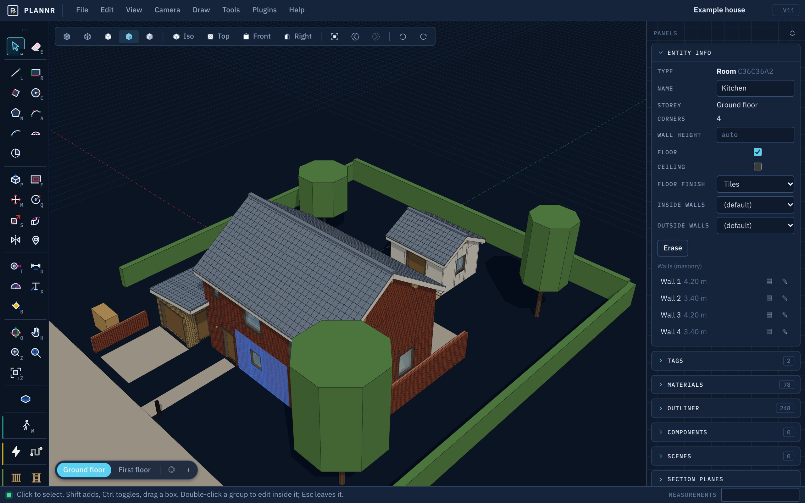
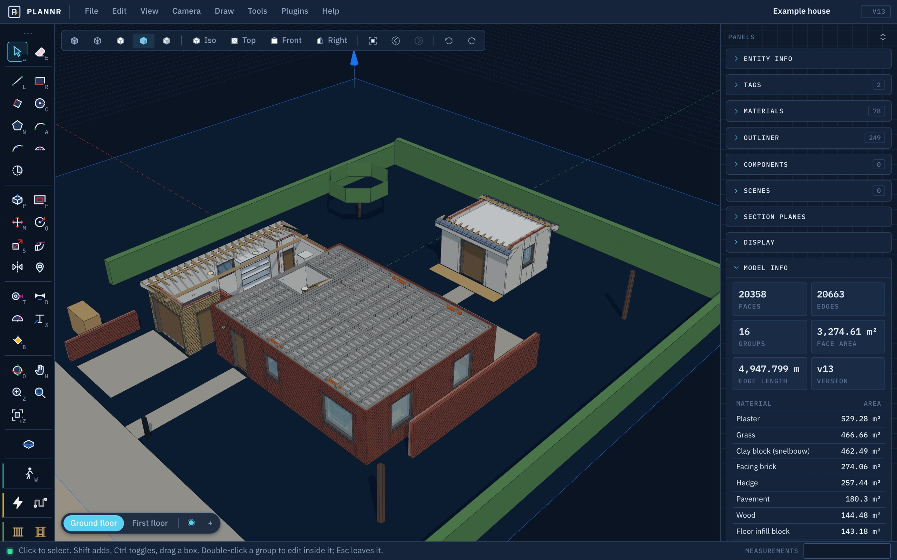
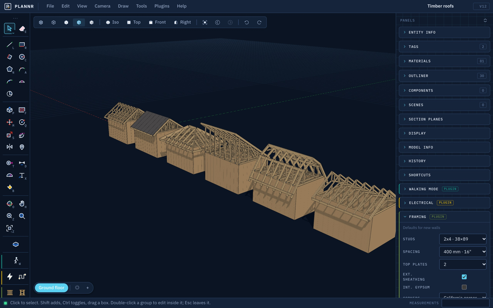
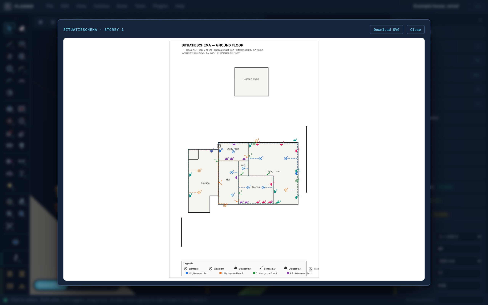
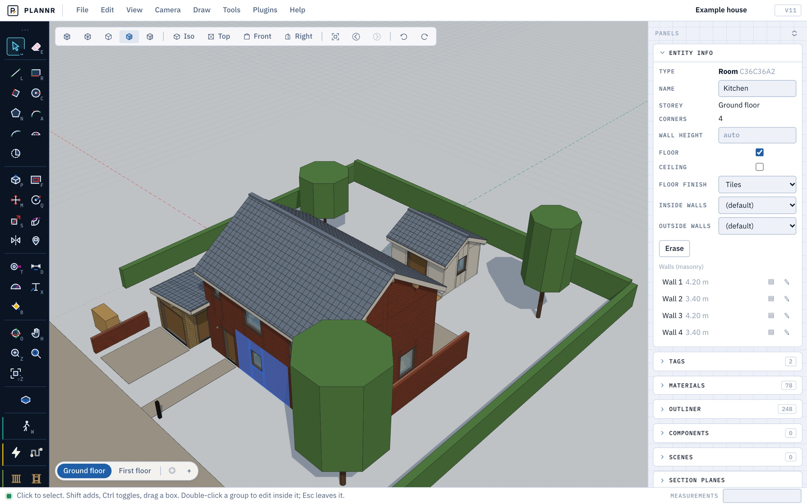

# Plannr

**Try it: [plannr.m-dm.org](https://plannr.m-dm.org)** · ☕ [Buy me a coffee on Ko-fi](https://ko-fi.com/matthiasdm)

A SketchUp-style 3D modeller as a web app. A **Rust engine** owns the model and every modelling
operation; the browser is a viewport with the familiar tool set; and the same operations are exposed
over **MCP**, so an AI can draw, push/pull, move, measure, paint, annotate, change the camera and take
screenshots of what it made. The core is generic — domain tools (houses, rooms, pipes…) come as plugins.



```
crates/plannr-core     document model, ops kernel (draw / push-pull / offset / move / rotate / scale / …), undo history,
                       tessellation + section cuts, metrics, GLB export, plugin trait
crates/plannr-server   Axum REST API + WebSocket + MCP endpoint + SQLite + static hosting (port 8795)
web/                   Vite + TypeScript + three.js frontend (SketchUp-style UI)
docs/CONTRACT.md       the document / ops / REST / WebSocket / MCP contract
docs/PLUGINS.md        how to write engine and browser plugins, and how installable packages work
```

## A look inside

| | |
|---|---|
|  |  |
| Isolate a storey for a dollhouse view: cavity walls, beam-and-block floors and the material takeoff in Model Info. | Every timber roof type, framed on the same shed by the framing plugin. |
|  |  |
| The situation plan the electrical plugin draws: points as IEC symbols, numbered per circuit, conduits dashed. | The same model in the light theme. |

## Public instance mode

`PLANNR_PUBLIC=1` runs Plannr as a public site (this is how plannr.m-dm.org runs): the front page
(`web/home.html`) is served at `/` and the modeller at `/app`; every browser gets a random owner key
(kept in `localStorage`, sent as `X-Plannr-Owner`) and only ever sees the projects it made (at most 30);
the MCP endpoint is off, and installing or switching plugins needs the server's `PLANNR_TOKEN`. Without it, Plannr is a single-user local app with MCP.

## Run

```bash
cd web && npm install && npm run build && cd ..   # builds web/dist
cargo run --release -p plannr-server              # http://localhost:8795
```

The server prints an MCP token at startup (or set `PLANNR_TOKEN`). In the app, **Help → Connect an AI (MCP)…**
opens a panel that stays open: it shows the endpoint and the running server's token (when the browser is on the
same machine), lets you test it, and hands you the
command below and a JSON config for other MCP clients with the token filled in. Connect Claude Code with:

```bash
claude mcp add --transport http plannr http://localhost:8795/mcp --header "Authorization: Bearer <token>"
```

Frontend development: keep the server running and use `cd web && npm run dev` (Vite proxies `/api`).
Tests: `cargo test`. Type-check: `cd web && npx tsc --noEmit`.

## Tools

| Tool | Key | Notes |
|---|---|---|
| Select | Space | Shift adds, Ctrl toggles, Shift+Ctrl takes away, triple-click selects every drawn face and edge connected to the one clicked, drag a window (left→right) or crossing box (right→left), double-click enters a group or opens a plugin object (a construction wall or roof: select one face; a framed wall: single studs and plates), Esc leaves |
| Eraser | E | Click or drag over edges, faces, objects; with Shift held they are hidden instead. Erasing the edge between two faces of one plane joins them. With Ctrl (or Alt) held the edges you go over are softened, with Shift+Ctrl made hard again |
| Freehand | — | Press and drag to draw by hand on the face or the ground under the first point; let go where you began to close the shape into a face |
| Line | L | Chained edges; a closed coplanar loop becomes a face, a line across a face divides it. Type a length, a position `[x;y;z]` or a step from the last point `<x;y;z>` (model coordinates, y is up) |
| Rectangle | R | Two corners on the ground or on any face; type `w;h` |
| Rotated Rectangle | — | First edge with two clicks, then the width: a rectangle at any angle in the plane |
| Circle | C | Centre + radius; type `24s` for the number of sides |
| Polygon | N | Click corners, Enter closes; type a length for the side being drawn. Type `6s` for a regular polygon: centre, then a corner (or type the radius); `0s` goes back to free corners |
| Arc / Pie | A | Centre, start, end (type a radius, then an angle); Pie closes the sector into a face |
| 3 Point Arc | — | Start, a point on the arc, end |
| 2 Point Arc | — | Both chord ends, then pull the bulge: it turns cyan where the arc runs on smoothly from an edge at either end (tangent). Type the bulge, or a radius as `2r` |
| Push/Pull | P | Extrude a face; on a solid the face moves with its neighbours, and pushed through to the far side it cuts an opening. Type a distance; the height snaps to other geometry. Double-click a face to repeat the last distance. Ctrl (after taking hold of the face) builds on the face instead of moving it: the solid keeps its shape and the face stays as a floor between. With a face selected first, click anywhere to pull it |
| Offset | F | Offset a face's outline in or out, dividing the face (the selected face, when there is one). Double-click a face to repeat the last offset. With two or more connected edges selected, the line they form is copied to one side instead |
| Move | M | Move or (Ctrl) copy; type a distance. With a selection, that is what moves, wherever you grab. Drawn faces take the faces around them along; with nothing selected a single edge or corner can be moved. After a copy, type `3x` for three copies in a row or `/3` for three spread evenly up to it |
| Rotate | Q | Protractor: centre (on a face = its plane), reference, angle; type degrees or a slope (`1:6`). A drawn face turns with the faces around it. Ctrl makes a copy; then `5x` or `/5` makes a ring of copies |
| Scale | S | Green handles on the selection's box: corners uniform, side handles one axis, edge handles two; Ctrl scales about the centre; type a factor or `sx;sy;sz`, or a size with its unit (`2m`) to make the selection that large. A drawn face scales with the faces around it |
| Follow Me | — | Click the profile face, move along the edges it should follow (round a loop too) and click. Or select the path first (edges, or a face whose outline is the path) and click the profile |
| Flip / Mirror | — | Mirrors the selection across a plane through its centre (→ ← ↑ pick the axis) or across a clicked face; Ctrl keeps a copy |
| Place Component | — | Drops an instance of a component definition (Edit → Make Component turns a selection into one); ← → turn it by 90° |
| Box | — | Solid tools: a closed box solid (its own group). Two corners of the base on the ground or on a face (type `w;d`), then the height (type it) |
| Cylinder | — | A closed cylinder solid: centre and radius of the base on the ground or a face, then the height; type `48s` for the number of sides |
| Trim / Split | — | Trim cuts like Subtract but leaves the cutter in place. Split leaves both solids, cut along each other, and makes the part they share a third solid. (Union on two overlapping solids is SketchUp's Outer Shell) |
| Union / Subtract / Intersect | — | Booleans between solids (groups whose faces close up): click the solid to keep, then the one to join, cut away or intersect with; the first stays picked for the next cut. The result's coplanar pieces merge into clean faces (a wall with slots is one face with holes) |
| Tape Measure | T | Measure; start on an edge to pull a parallel guide line; Ctrl-click places a guide point. After measuring, type a new length to resize the whole model so the measured distance becomes it |
| Dimension | D | Two points (or click an edge for its length), then the offset. Click a circle for its diameter or an arc for its radius (R and D switch), then where the label goes |
| Angular Dimension | — | Click the two edges of an angle (which side of each you click decides which angle is meant), or its corner and a point on each leg, then where the arc goes: an arc with the angle in degrees stays in the model |
| Protractor | — | Vertex, reference direction, angle: places an angled guide line; type degrees or a slope (`1:6`) |
| Text | X | Click a point, an edge or a face for a label with a leader: it starts as the position, the length or the area. Click empty space for screen text, which stays in place in the view |
| 3D Text | — | Type the text, pick font, height and how far the letters stand out, then click where it goes: on a face the letters lie on that face (upright on a wall), elsewhere on the ground. The result is a group; extruded letters are solids, so they can be cut out of something with Subtract |
| Axes | — | Moves the drawing axes: click the new origin, a point along the red axis, then a point on the side the green axis goes (Enter after the origin keeps the directions). Inference, axis locks, the grid, typed positions and the way rectangles are squared up follow them, so a building that stands at an angle can be drawn as if it were square. View → Reset axes puts them back |
| Paint Bucket | B | Active material onto a face. Ctrl: every connected face with the same material; Shift+Ctrl: every such face of the shape; Shift: whole object; Alt: sample. (Ctrl and Alt do not switch to Orbit and Pan while this tool is active) |
| Orbit / Pan / Zoom | O / H / Z | Middle-drag (or right-drag) orbits, Shift+middle pans, wheel zooms in any tool; Shift+Z zoom extents |
| Zoom Window | — | Drag a rectangle to fill the view with it; ⌘[ and ⌘] step through previous and next views |
| Section Plane | — | Click a face to cut along it, the ground for a horizontal cut; the plane is previewed while hovering, its arrows on the side that is cut away (Tab flips it; Reverse later in Entity Info). Several active planes cut together |

**Edit:** Cut, Copy and Paste (⌘X / ⌘C / ⌘V) work on the selection, also between projects: the copy follows the
cursor by its lowest corner until you click; ⇧⌘V pastes in place. **Lock** (Edit menu, right-click) keeps something
from being moved, changed or erased until it is unlocked; it can still be selected, copied and hidden.

**Soften edges** (Edit menu, right-click) makes a faceted surface look round: where the selected faces, or the faces
inside the selected groups, meet at up to the angle you give (20° suits most curves), the edge between them is no
longer drawn and the surface is shaded smooth across it. Sharper edges stay, so a cylinder softened at 35° loses its
seams and keeps its rims. **Unsoften edges** makes them hard again. The softening is kept per face, so it survives
moving, copying and reshaping; View → Hidden Geometry shows the soft edges.

**Camera:** Camera → Parallel projection shows the model without perspective (a 1° lens from far away), Field of
view sets the lens (35° by default). **Shadows:** Display → Sun → By date and time puts the sun where it stands at
that hour, month and latitude (north is where the Front view looks). **Scenes** keep the view, the active section
planes, which tags show, the face style, the lens and the sun.

**Units:** Model Info → Units switches between metres, centimetres and millimetres and sets the decimals. Labels,
dimensions and the Measurements box follow, and a bare number you type is in that unit (`500` is 500 mm); a unit
you type yourself always wins (`2m`). The document stays in metres.

**Import and export:** File → Import model reads `.obj`, `.stl` and `.dxf` files as one group (triangles in one plane
are joined into faces; you are asked for the file's unit). File → Export writes `.glb`, `.obj` (metres, y up), `.stl`
(millimetres, z up, for printing) and `.dxf` of what is in view.

**DXF:** a text (ASCII) DXF comes in with its lines, polylines (bulges included), circles, arcs, ellipses and splines
as edges, its 3D faces, solids and meshes as faces, and each block reference as a group inside the imported group.
Layers become tags of the same name, with their colour; a layer that is off or frozen in the file comes in switched
off. Circles and arcs keep their centre for the Center inference. Closed outlines stay edges: they are not filled
with a face. Text, dimensions, hatches and ACIS solids are left out, and the message after the import says how many.
The unit is taken from the file when it names one (mm, cm, m, in, ft). Export writes an R12 DXF in the document's
unit, z up: every face as 3DFACE triangles and every edge as a LINE, on layers named after the tags.

**Right-click** something for its menu: Cut, Copy, Erase, Hide, Lock, Select connected, Select all with the same tag, Make group,
Make Component, Explode, Edit group, Intersect faces (edges where the selected faces or groups cross anything else in the model; inside an open group they divide its faces),
Reverse faces, Soften edges, Unsoften edges, Zoom Selection. Over empty space: Undo, Redo, Paste, Select all, Unhide all, Zoom Extents. Dragging with
the right button still orbits.

**Hold a modifier for a tool:** holding Ctrl orbits and holding Option/Alt pans until you release the key,
then you are back in the tool you had. Which key does what is set in the Shortcuts tray (Shift can be
assigned too; by default it keeps its selection meaning).

Inference as in SketchUp: green endpoint, cyan midpoint, red on-edge, blue on-face dots, black
intersection crosses, axis-coloured lines, magenta parallel/perpendicular to an edge you rested the
cursor on, dotted **from point** lines from points you rested on or clicked, guide points and lines,
the centres of circles, arcs and polygons, and the origin. The **arrow keys lock an axis** (→ red x, ← green z, ↑ blue y) and **Shift holds the
inference under the cursor** (a direction, a face's plane, or the axis a snapped point lies on): while it is down the point stays on that line and other geometry only projects onto it. Held, the point follows the cursor along the line and stops only where it meets an edge or inference line, or level with a corner right under the cursor. In Push/Pull, Shift keeps strictly to the face normal; without it the height is taken only from a corner, midpoint or centre right under the cursor. Points hidden behind faces never snap, also while moving. Lengths along inferred lines snap to
1 cm. Numbers typed while a tool is active go into the **Measurements** box.

Trays: Entity Info, Tags (layers), Materials, Outliner, Scenes, Section Planes, Display, Model Info,
History, Plugins.

**Textures:** a material is a colour or an image. In the Materials tray, Texture takes an image file (PNG or JPEG, scaled down to 1024 pixels) or one of the ready-made patterns (brick, roof tiles, wood boards, floor tiles, concrete, asphalt, grass); Width and Height say how many metres one copy of the image covers (a new width keeps the proportions, a new height stretches). The image runs level across each face and up its slope, measured from the origin of the group the face is in: it carries on across faces in one plane, its rows line up around a corner, and it moves along with its group. Loose faces that are moved slide under their texture. Textures show in the Shaded and X-ray styles and go into the glTF export; the image is kept in the document.

**Hide and show:** Edit ▸ Hide (⌘E) hides the selection, a group or component with everything in it; Unhide selected, last or all (⇧⌘E) bring it back, and the Outliner has an eye per row. View ▸ Hidden geometry shows hidden entities as ghosts you can select. Hidden entities stay in the document but leave slices and exports.

**Face styles** as in SketchUp, in the view bar and View ▸ Face style (⌥1–5): X-ray, Wireframe, Hidden Line, Shaded, Monochrome, plus Back edges (dashed lines for what is behind faces).

**Light or dark:** View ▸ Theme (or the Display tray) switches between System, Light and Dark for the
chrome and the viewport; the choice is remembered in the browser, and the front page shares it.

## Embedding

Another app can show a project in an iframe (`/app?project=<id>&embed=1&owner=<key>`): viewer mode
with the looking, measuring and section tools only, driven over `postMessage` (storeys, views, zoom to
an entity, selection, screenshots, any op). An app that keeps its own house model pushes it with the
construction plugin's `import_house` (install the Construction plugin), which replaces the previous import and leaves what was drawn
beside it. See [docs/EMBED.md](docs/EMBED.md) and `web/public/embed-example.html`.

## MCP

Every tool is an MCP tool with the same semantics (`draw_line`, `draw_rectangle`, `draw_circle`,
`draw_polygon`, `push_pull`, `offset`, `move`, `rotate`, `scale`, `copy`, `erase`, `paint`, `make_group`,
`explode`, `draw_arc`, `follow_me`, `mirror`, `solid_box`, `solid_cylinder`, `extrude`, `boolean`, `make_component`, `place_component`, `edit_component`, `make_unique`,
`add_guide`, `add_dimension`, `add_text`, `text3d`, `soften`, `add_section`, `measure`, …), plus project tools
(`list_projects`, `create_project`, `use_project`, `get_document`, `list_entities`, `undo`, `redo`),
viewport tools that drive the open browser (`screenshot`, `set_view`, `set_camera`, `zoom_extents`,
`zoom_to`, `zoom_window`, `previous_view`, `next_view`, `orbit`, `pan`, `zoom`, `select`, `activate_tool`, `get_view_state`) and `export_glb`.
`screenshot` returns a PNG of the viewport, so the model can look at what it built.

## Plugins

The core knows only faces, edges, groups, guides, dimensions, texts and section planes. Everything
domain-specific comes as a plugin with an engine half (Rust: custom entity types expanded into core
geometry, custom ops that become MCP tools `plugin.<id>.<op>`, export formats) and a browser half
(tools, panels, Entity Info). Plugins are **installable packages**: download a `.plannr-plugin` file and
install it with **Plugins → Manage plugins… → Install from file**; the same dialog switches each one on
and off and removes it. Their engines run as WebAssembly in a sandbox inside the server. A fresh Plannr
has none: it is a plain SketchUp-style modeller until you add some.

They live in [plannr-plugins](https://github.com/MatthiasDM/plannr-plugins), each with its own release:

| Plugin | |
|---|---|
| **Construction** | houses from rooms: storeys, rooms of any shape with shared walls built once, Belgian masonry (cavity walls coursed brick by brick, beam-and-block floors, lintels, foundations), doors and windows as real holes, flat / gable / hip / shed roofs, fixtures, pipe and cable runs, parametric furniture, takeoff, checks and U-values, the import of Uzzetje house models |
| **Electrical** | the installation to AREI/RGIE: board, circuits, conduits, checks, situation plan and one-line diagram (needs Construction) |
| **Framing** | Medeek-style wood framing: walls, floors, every timber roof type, beams, stairs, foundations, hardware, engineering check, plans, cut list |
| **Plumbing** | pipes with bends or fittings, valves, mixers, manifolds, brackets, checks, material list |
| **Walking mode** | first-person walk-through with every tool at hand, on desktop and phone |
| **3D Print** | 3MF / STL for slicers, watertight check and repair, plate layout |
| **Car Track** | printable 1:64 die-cast track with connectors, supports and a test drive |

See [docs/PLUGINS.md](docs/PLUGINS.md) to write one.

## Document

One JSON document per project: layers, materials, entities (`face`, `edge`, `group`, `guide`,
`dimension`, `text`, `section`, `custom`), scenes and per-plugin extensions. See
[docs/CONTRACT.md](docs/CONTRACT.md).

## License

MIT — see [LICENSE](LICENSE).
